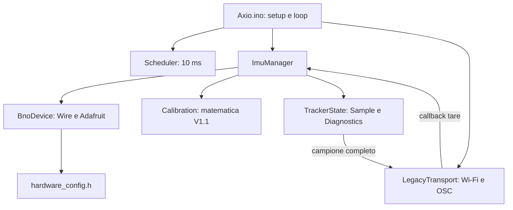

# Verifiche Fase 1 — 5 novembre 2026

Branch `feat/core-refactor`. Modularizzazione software completata. Ricezione OSC
reale e tara verificate dall'utente; rate IMU ed equivalenza temporale NOT RUN.
I risultati hardware aggiornati sono nella sezione finale. Nessun commit automatico, push, installazione, upload o
modifica della configurazione del computer. Toolchain e opzioni invariate in
`toolchain.lock.json` e `scripts/compile.sh` (FQBN `esp32:esp32:XIAO_ESP32C3`).

## Architettura e dipendenze



Il core non include OSC, Wi-Fi, Preferences o WiFiManager. L'adattatore hardware
è distinto dalla logica di acquisizione, testabile con device e clock minimi
senza dispatch virtuale, nuove dipendenze o task FreeRTOS. Il trasporto mantiene
insieme portale, preferenze e OSC per limitare l'intervento sul codice storico;
non è il futuro NetworkManager o motore OSC.

`Calibration` conserva coniugato, prodotto offset * corrente, conversioni
quaternion double → float, yaw con offset int, cast verso zero e resto C++,
ordine e precisione delle espressioni pitch/roll, matrice accelerazioni, divisioni
per 35.0 e gyro int/1500.0. Nessuna normalizzazione quaternion, clamp, inverse,
scambio assi o modifica della modalità NDOF. Riferimenti iniziali identità e yaw
zero, nessuna tara automatica o persistenza. Il solo ingresso comandi è
`ImuManager::calibrateReference()`, che aggiorna entrambi i riferimenti solo dopo
le due letture riuscite. `/tare` continua a invocarlo senza risposta OSC.

`Sample` contiene quaternion grezzo double, Euler/accelerazione lineare/gyro
in unità Adafruit, quaternion relativo double, componenti relative float e tutti
i valori normalizzati trasmessi; timestamp monotono in microsecondi a fine
lettura e sequenza uint64_t dal valore 1. `RawSample` e `Sample` sono valori
sullo stack e in RAM, senza allocazioni ripetute nell'acquisizione. Le
allocazioni interne iniziali Adafruit e quelle storiche del bundle OSC restano.
Nessuna nuova scrittura flash: restano solo preferenze iniziali/salvate dal portale.

La pubblicazione avviene dopo tutte le letture e i calcoli; invio e futuri
consumatori usano il campione senza nuove letture I²C. Non è un'istantanea atomica
dei registri BNO055: quattro transazioni sequenziali, senza latch né controllo
dell'aggiornamento interno. Il timestamp non è il tempo fisico di fusione.

## Errori e recupero

Stati: `Uninitialized`, `Ready`, `InitFailed`, `ReadError`. Se begin fallisce,
nessuna acquisizione né tara e nessun retry applicativo, come per l'acquisizione
storica. Per le letture è usato l'Adafruit BusIO già dipendente da BNO055:
stessi registri, lunghezze, endian e fattori di conversione della 1.6.4; il
risultato booleano di `write_then_read` viene ora controllato. Il secondo handle
BusIO viene inizializzato una sola volta con `begin(false)`, senza probe extra.
I metodi Adafruit `getQuat/getVector` ignorano invece il risultato I²C.

Un blocco fallito interrompe l'acquisizione: nessuna pubblicazione, nessun
bundle, sequenza e timestamp invariati. `latest.valid` indica l'esistenza di un
ultimo campione valido, non la freschezza del sensore: leggere anche `sensor`
e timestamp. Prima del primo successo rimane false. Al successivo turno normale
si riprova la lettura; il successo riporta `Ready`. Nessun reset BNO, bus recovery,
retry aggiuntivo o ciclo di reinizializzazione. Una tara fallita mantiene entrambi
i riferimenti. I contatori di errore tara e lettura sono separati: una tara con
inizializzazione fallita incrementa solo `tareErrors`; un errore I²C durante tara
incrementa anche `readErrors`.

ACK e lettura completa non dimostrano salute della fusione: registri congelati,
valori fisicamente implausibili, errori silenziosi e qualità calibrazione interna
non sono rilevati. I byte decodificati sono finiti e nei range dei registri;
nessuna nuova politica di rigetto o correzione dei valori viene applicata.
Un futuro recupero sostanziale richiederà prove unplug/replug, decisioni su retry,
backoff, reset/remap/cristallo e validità della tara: solo piano, non implementato.

## Temporizzazione e strumenti di misura

Ordine del loop conservato: portale, controllo periodo, acquisizione e invio
immediato, ricezione di al massimo un datagramma OSC. Scheduler `uint32_t` con
sottrazione unsigned di `millis()`, soglia 10 ms e assegnazione `last=now`:
nessun catch-up. Il rollover del contatore a 32 bit è testato; come in V1.1,
non supporta una pausa pari a un intero giro del clock senza osservazioni.
Timestamp e durate usano `esp_timer_get_time()` monotono a 64 bit, non una
estensione di `millis()` e non un orologio civile. Il ritardo di 1000 ms e le
attese delle librerie restano solo dove storicamente presenti nell'inizializzazione;
lo scheduler non aggiunge delay. I²C, portale e UDP restano chiamate sincrone.

Differenza temporale nota: prima i calcoli erano intercalati alle letture;
ora si leggono prima tutti i blocchi (quaternion, Euler, lineare, gyro), poi si
calcola e pubblica. Le letture successive possono quindi cadere in istanti
diversi. Copie del campione, controllo errori, contatori e clock aggiungono
lavoro. Nessuna equivalenza temporale dichiarata, nessuna misura di overhead,
rate o jitter hardware disponibile.

Strumentazione già presente, senza seriale periodica o nuovi pacchetti:
`tracker.diagnostics` conserva `attempts`, `acquired`, `readErrors`, `initErrors`,
`tareRequests`, `tareErrors`, `sendAttempts`; `lastReadUs/maxReadUs` misurano le
quattro letture (o il prefisso fallito), `lastStartUs` l'inizio dell'ultimo
acquisto tentato, `lastIntervalUs/maxIntervalUs` gli intervalli fra tentativi,
`lastSendUs/maxSendUs` serializzazione più tentativo UDP. Letture della tara
non entrano nei tempi o nel numero di acquisizioni periodiche. Un invio tentato
non prova consegna UDP; non è aggiunto controllo dell'esito di rete.

Per misurare successivamente: osservare queste strutture RAM e `latest` nel
debugger usando `.build/artifacts/Axio.ino.elf`, oppure esportarle a bassa
frequenza in una build di misura separata. Fra due osservazioni di
`acquired` e dei timestamp calcolare delta campioni / delta tempo; registrare
anche gli errori e il numero di tentativi. Per jitter statistico serve una serie
di timestamp/intervalli, non basta il massimo. Fermare la CPU nel debugger o
stampare seriale altera le misure: scartare tali intervalli e quantificare
l'overhead di qualsiasi esportazione. Nessuna nuova interfaccia pubblica di
telemetria è stata introdotta. Rate delle chiamate e rate interno BNO055 restano
misure distinte, come descritto in `benchmarks.md`.

## File creati e modificati

Creati:

- `firmware/Axio/src/core/Sample.h`
- `firmware/Axio/src/core/Calibration.h`
- `firmware/Axio/src/core/Diagnostics.h`
- `firmware/Axio/src/core/TrackerState.h`
- `firmware/Axio/src/core/Scheduler.h`
- `firmware/Axio/src/core/ImuManager.h`
- `firmware/Axio/src/core/BnoDevice.h`
- `firmware/Axio/src/transport/LegacyTransport.h`
- `firmware/Axio/src/transport/LegacyTransport.cpp`
- `tests/fixtures/phase0-Axio.ino`
- `tests/core_math_harness.cpp`
- `tests/core_state_harness.cpp`
- `tests/bno_device_harness.cpp`
- `tests/stubs/Adafruit_BNO055.h`
- `tests/stubs/Adafruit_I2CDevice.h`
- `tests/stubs/Wire.h`
- `tests/test_core.py`
- `docs/phase1-verification.md`

Modificati: `firmware/Axio/Axio.ino`, `firmware/Axio/src/README.md`,
`tests/test_baseline.py`, `README.md`, `AGENTS.md`, `docs/benchmarks.md`,
`firmware/Axio/hardware_config.h`.
Dopo la conferma hardware dell'utente, `hardware_config.h` definisce SDA GPIO6
(D4), SCL GPIO7 (D5) e indirizzo BNO055 0x29. `BnoDevice` usa esclusivamente
`SDA_PIN`, `SCL_PIN` e `BNO055_I2C_ADDRESS` per questi valori. Nessun altro modulo
contiene definizioni numeriche dei GPIO. Reference, lock e script di build invariati.

Il test byte della Fase 0 verifica ora la fixture congelata, non lo sketch
modulare: il vincolo copia identica della Fase 0 non è applicabile al refactoring.
L'assert confronta ancora tutti i byte contro la reference con la sola
sostituzione dei pin e verifica lo stesso hash SHA-256 originale. Nessun vettore,
asserzione matematica, tolleranza o test OSC storico rimosso. In aggiunta i
1.345 vettori vengono eseguiti sul vero `Calibration.h` e confrontati sia con
l'oracolo Python sia con l'output testuale esatto dell'harness baseline su host.
Non è una prova bit per bit della matematica sul processore ESP32.

## Risultati software

| Verifica | Stato | Evidenza / limite |
| --- | --- | --- |
| Toolchain bloccata e FQBN | PASS | Preflight build, nessuna installazione |
| Build Axio | PASS | `.build/phase1-compile-final.log` |
| Build baseline | PASS | `.build/phase1-baseline.log` |
| Hash reference e copia Fase 0 | PASS | Test storico, fixture byte per byte |
| Matematica V1.1 | PASS | 1.345 vettori invariati su baseline e core, oracolo e confronto host esatto |
| Suite completa | PASS | 11 test, `.build/phase1-tests.log` |
| Tara iniziale, aggiornamento, fallimento | PASS | Core reale, device e clock fake |
| Campioni, sequenza e timestamp | PASS | Nessun avanzamento su errori, nessun campione valido prima del primo successo |
| Errori acquisizione / inizializzazione | PASS | Fallimento in ciascuno dei quattro blocchi, init assente, successo successivo |
| Registri e conversioni BNO055 | PASS | Adattatore reale con stub BusIO; endian con segni, divisori, ordini, esito fallito |
| Scheduler / rollover | PASS | Soglia, salti senza catch-up e wrap uint32_t; timestamp sample oltre 32 bit |
| Serializzazione OSC reale senza I²C | PASS | Funzione di produzione con fake OSC, indirizzi/ordine/valori e un solo invio |
| Parser e UDP localhost | PASS | Test Fase 0 invariati, con permesso socket fuori sandbox |
| Diff whitespace e sintassi shell | PASS | `git diff --check`, `bash -n scripts/compile.sh` |
| Arduino IDE GUI | NOT RUN | Compilata via CLI la struttura Arduino compatibile |
| Ricezione OSC reale dalla XIAO | PASS | Riepiloghi di due catture forniti dall'utente, dettagli nella sezione finale |
| Tara fisica | PASS | Verifica funzionale confermata dall'utente; nessuna misura quantitativa della precisione |
| Wi-Fi: portale, persistenza, riconnessione | NOT RUN | La ricezione sulla rete reale non verifica questi scenari |
| Rate IMU, jitter, overhead e prestazioni | NOT RUN | Nessuna equivalenza temporale dedotta dalle build o dal loopback |

La prima suite in sandbox ha dato FAIL soltanto sul bind UDP localhost
(`Operation not permitted`). Rieseguita fuori sandbox con permesso: PASS.
Nessun FAIL software irrisolto. Warning preesistenti della prima build:
fallthrough `OSCMessage.cpp:897` e `%d` con `uint32_t` nel debug
`WiFiManager.cpp:3368`; nessun warning nuovo del core Axio. Le build con cache
possono non ristampare i warning; log iniziale `.build/phase1-compile.log`.

## Flash e RAM

Stesse opzioni, toolchain e partizione default 4 MB:

| Build | Flash programma (max 1.310.720) | RAM globale (max 327.680) | RAM residua dichiarata |
| --- | ---: | ---: | ---: |
| Fase 0 / baseline ricompilata | 1.124.989 | 39.356 | 288.324 |
| Axio Fase 1 | 1.126.869 | 39.660 | 288.020 |
| Differenza | +1.880 | +304 | -304 |

Flash 85%, RAM globale 12% per entrambe. Il dato RAM è statico: non misura
picco stack, heap del bundle/portale o margine runtime. Nessun benchmark di
prestazioni o affidabilità dedotto da queste dimensioni.

## Differenze, rischi e prove XIAO

Wi-Fi/portale, preferenze, hostname/AP storico senza password, IP/porta/ID e
socket locale 16889 restano invariati. Bundle immediato con `/ypr<ID>`,
`/real<ID>`, `/world<ID>`, `/gyro<ID>`, ognuno con tre float nello stesso ordine.
Non vengono trasmessi timestamp, sequenze o diagnostica. Ricezione ancora come
OSCMessage, senza bundle in ingresso. Rischi storici (buffer hostname,
validazione portale, target 0.0.0.0, AP aperto) restano documentati nella baseline.
Non è un requisito Legacy permanente per il prodotto finale.

Differenze intenzionali: rilevamento errori I²C con scarto completo del campione;
tara assente/fallita non altera i riferimenti; dati dell'ultimo valido, timestamp,
sequenza e contatori in RAM; raggruppamento delle letture prima dei calcoli.
Fusion mode, remap e conversioni restano invariati; lo stato `Ready` descrive
l'esito delle operazioni, non la calibrazione Bosch.

La checklist seguente era inizialmente tutta NOT RUN. Ricezione OSC e tara
funzionale sono ora PASS secondo le evidenze dell'utente riportate in fondo;
gli altri scenari restano da verificare:

1. Cablaggio SDA GPIO6/D4, SCL GPIO7/D5 e indirizzo 0x29 confermati dall'utente.
   Restano da provare inizializzazione, alimentazione, cristallo e remap P0;
   nessuna verifica hardware eseguita dall'agente.
2. Compilare in Arduino IDE, scegliere la porta e fare upload solo su decisione
   dell'utente; controllare messaggi seriali di inizializzazione e sensore assente.
3. Verificare Wi-Fi, portale, riavvio e persistenza configurazione come Fase 0.
4. Catturare OSC reale e `/tare`, confrontare ordine/tipi/valori, yaw ai limiti,
   segni/assi, accelerazione relativa e tarature ripetute con pose note.
5. Provare fallimenti I²C e sensore assente, nessun bundle spurio, riferimenti
   invariati su tara fallita e recupero della lettura senza reset automatico.
6. Confrontare almeno tre finestre di baseline/Fase 1, fermo/movimento/portale,
   rate e jitter di ricezione separati da quelli delle letture firmware; registrare
   durate read/send, intervalli, errori, overhead della strumentazione, heap/stack.
   Il rate interno BNO055 richiede una misura distinta.

## Riproduzione

```sh
cd /Users/franc/apps/axio
mkdir -p .build
bash scripts/compile.sh > .build/phase1-compile-final.log 2>&1
bash scripts/compile.sh --baseline > .build/phase1-baseline.log 2>&1
python3 -B -m unittest discover -s tests -v > .build/phase1-tests.log 2>&1
bash -n scripts/compile.sh
git diff --check
shasum -a 256 reference/HandTrackerV1_1.ino
```

Il test UDP richiede permesso localhost se il sandbox lo vieta. Harness,
artefatti, cache e log sono in `.build/`; catture reali soltanto in `captures/`.
Nessuna Fase 2 avviata.

## Verifica dopo conferma della mappa hardware

Configurazione corrente: `SDA_PIN=6` (D4), `SCL_PIN=7` (D5),
`BNO055_I2C_ADDRESS=0x29`, tutti in `hardware_config.h`. L'unica chiamata
applicativa di inizializzazione è `Wire.begin(SDA_PIN, SCL_PIN)` in `BnoDevice`;
anche l'indirizzo dei due handle Adafruit proviene dal define. Nessuna modifica
alle formule, ai riferimenti di taratura o al protocollo.

- PASS: `bash scripts/compile.sh`, log `.build/hardware-update-compile.log`.
  Flash 1.126.869 B e RAM globale 39.660 B, invariate rispetto alla Fase 1 sopra.
- PASS: `python3 -B -m unittest discover -s tests -p 'test_baseline.py' -v`,
  3 test, inclusi i 1.345 vettori e l'integrità baseline/fixture.
- PASS: `python3 -B -m unittest discover -s tests -p 'test_core.py' -v`,
  3 test, incluso l'adattatore BNO055 che verifica i pin passati a Wire.
- PASS: `git diff --check`. Test OSC/UDP non rieseguiti per questo aggiornamento.
- NOT RUN: prove funzionali sulla XIAO; la mappa è confermata dall'utente,
  senza nuove misure hardware dell'agente.

Log dei test in `.build/hardware-update-baseline-tests.log` e
`.build/hardware-update-core-tests.log`. Baseline storica immutata con GPIO 5/6;
le note nei documenti della Fase 0 distinguono quei valori dalla mappa corrente.


## Risultati hardware riferiti dall'utente

L'utente ha fornito i riepiloghi dell'analizzatore per due prove sulla XIAO e
ha confermato personalmente il funzionamento della tara. Nessuna misura hardware
è stata eseguita dall'agente; file JSONL grezzi, istante della tara, hash del
firmware caricato e condizioni dettagliate non sono stati esaminati.

| Metrica di ricezione sul Mac | Prova senza tara | Prova con tara a metà |
| --- | ---: | ---: |
| Datagrammi UDP / pacchetti OSC validi | 4.986 / 4.986 | 2.844 / 2.844 |
| Messaggi OSC | 19.944 | 11.376 |
| Pacchetti invalidi | 0 | 0 |
| Pacchetti ricevuti/s | 99,828483 | 99,852642 |
| Intervallo medio (ms) | 10,017181 | 10,014758 |
| Intervallo mediano (ms) | 10,047292 | 10,040500 |
| Intervallo p95 (ms) | 12,887208 | 12,891916 |
| Intervallo massimo (ms) | 19,548167 | 24,162041 |
| Jitter, deviazione standard popolazione (ms) | 1,606627 | 1,692328 |

- PASS: ricezione OSC reale, quattro messaggi per pacchetto in media e nessun
  pacchetto invalido nei riepiloghi. Questi conteggi non verificano da soli
  indirizzi, tipi e valori di ogni messaggio, né dimostrano assenza di perdite.
- PASS: tara funzionale sulla XIAO, verificata e confermata dall'utente.
  Non equivale a una misura quantitativa della precisione o a tutti i test di
  assi, limiti yaw e tarature ripetute previsti nella checklist.
- NOT RUN: frequenza delle acquisizioni firmware, frequenza interna BNO055,
  jitter delle acquisizioni, equivalenza temporale con baseline e overhead.
  Il jitter di ricezione riportato sopra è invece misurato dal Mac. Non è
  possibile attribuire il massimo intervallo della seconda prova alla tara.

Queste misure mancanti non bloccano la chiusura software della Fase 1; restano
attività di caratterizzazione successive. La Fase 2 non è autorizzata da questo
aggiornamento. Aggiornata solo la documentazione: compilazione e test non
rieseguiti, risultati software precedenti invariati.
